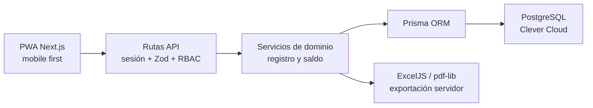

# Arquitectura simplificada

## Problema

La aplicación es una libreta de horas compartida. El administrador asigna un
horario y el usuario solo registra qué ocurrió en su día. El sistema transforma
ese registro en minutos trabajados, saldo, deuda y recuperación.

## Diseño



Next.js contiene la interfaz y la API, pero la base de datos solo es accesible
desde módulos marcados para servidor. Los componentes React no reciben
`DATABASE_URL` ni calculan el saldo definitivo.

## Módulos

```text
src/
├── app/
│   ├── (auth)/                 # inicio y recuperación
│   ├── (protected)/            # dashboard, registro, historial, reportes, admin
│   └── api/                    # endpoints HTTP
├── components/
│   ├── admin/
│   ├── dashboard/
│   ├── forms/
│   ├── pwa/
│   └── registration/
├── domain/
│   ├── rbac.ts
│   └── time-balance-service.ts
├── lib/                        # fechas y formato de minutos
└── server/
    ├── auth/
    ├── export/
    └── services/
```

## Decisiones

- **Un registro por día:** elimina solapamientos y cronómetros complejos.
- **Horario asignado:** el usuario no repite ni configura sus horas esperadas.
- **Fotografía diaria:** `scheduledMinutes` queda guardado en el registro.
- **Permiso explicativo:** no acredita tiempo; evita descontarlo dos veces.
- **Cálculo en servidor:** dashboard, historial, Excel y PDF usan la misma
  consulta de saldo.
- **Dos roles:** `ADMIN` y `USER`.
- **Sin offline transaccional:** la PWA solo cachea archivos estáticos.
- **Pool mínimo:** `DATABASE_POOL_MAX=1` respeta un PostgreSQL gratuito.

## Módulos eliminados

- equipos y supervisores;
- aprobaciones y tipos configurables de permisos;
- cronómetro, descansos separados y múltiples entradas;
- ajustes contables, cierres y auditoría extensa;
- notificaciones y preferencias del dashboard;
- IndexedDB y sincronización offline;
- Docker.

## Riesgos controlados

| Riesgo                           | Tratamiento                                         |
| -------------------------------- | --------------------------------------------------- |
| Deuda por días futuros           | Solo se finalizan fechas pasadas o días registrados |
| Doble descuento de permiso       | El saldo usa trabajado menos esperado               |
| Cambio posterior de horario      | Cada registro guarda sus minutos esperados          |
| Acceso a otro usuario            | RBAC en reportes y consultas                        |
| Cálculo distinto en exportación  | Ambos formatos consumen `buildReportData`           |
| Pocas conexiones de Clever Cloud | Una conexión por proceso                            |
