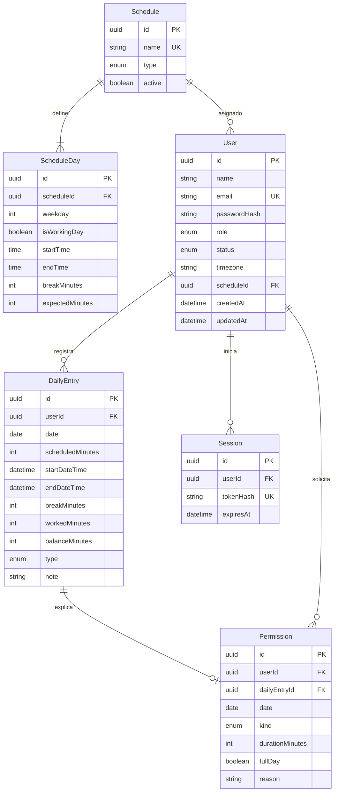

# Modelo entidad-relación

Existe una restricción única sobre `(DailyEntry.userId, DailyEntry.date)`.
PostgreSQL también verifica que:

- todos los minutos sean enteros no negativos;
- `balanceMinutes = workedMinutes - scheduledMinutes`;
- una entrada completa tenga salida posterior a entrada;
- los días de horario estén entre 1 y 7.

`AuthThrottle` es una tabla técnica independiente para limitar intentos de
inicio de sesión.
